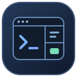

<p align="center">
  
</p>

<h1 align="center">MuxDesk</h1>

<p align="center">
  <strong>여러 터미널, 하나의 작업 공간.</strong><br />
  PowerShell · SSH · 브라우저를 한 화면에서 사용하세요.
</p>

<p align="center">
  <strong>Windows x64</strong> &nbsp;·&nbsp; v1.0.1 &nbsp;·&nbsp; 설치 없이 실행
</p>

<p align="center">
  <a href="https://github.com/lucid7132/MuxDesk/releases/latest"><strong>⬇ 다운로드</strong></a>
  &nbsp;&nbsp;·&nbsp;&nbsp;
  <a href="#시작하기">빠른 시작</a>
  &nbsp;&nbsp;·&nbsp;&nbsp;
  <a href="#기본-단축키">단축키</a>
  &nbsp;&nbsp;·&nbsp;&nbsp;
  <a href="https://github.com/lucid7132/MuxDesk/issues">문제 신고</a>
</p>

---

프로젝트마다 워크스페이스를 만들고, 터미널을 원하는 방향으로 나누고, 자주 쓰는 서버와 명령어를 바로 실행하세요. MuxDesk는 여러 작업을 한 화면에서 이어갈 수 있도록 돕는 Windows용 터미널 앱입니다.

<!-- 실제 Windows 실행 화면이 준비되면 이 위치에 추가합니다. -->

<table>
  <tr>
    <td align="center" width="33%"><h3>▦ 자유로운 화면 분할</h3>터미널을 상하좌우로 배치하고<br />드래그로 크기와 위치를 조절하세요.</td>
    <td align="center" width="33%"><h3>↗ SSH 빠른 접속</h3>서버와 SSH 별칭을 저장하고<br />목록에서 클릭해 접속하세요.</td>
    <td align="center" width="33%"><h3>⌘ 나만의 작업 공간</h3>프로젝트별로 화면을 나누고<br />이름·메모·아이콘으로 구분하세요.</td>
  </tr>
  <tr>
    <td align="center"><h3>›_ 저장 명령어</h3>반복하는 명령어를 등록해<br />선택한 터미널로 전송하세요.</td>
    <td align="center"><h3>◎ 내장 브라우저</h3>문서와 웹페이지를<br />터미널 옆에서 확인하세요.</td>
    <td align="center"><h3>↻ 작업 이어가기</h3>창을 다시 열어<br />터미널 세션과 배치를 이어가세요.</td>
  </tr>
</table>

## 시작하기

1. [Releases](https://github.com/lucid7132/MuxDesk/releases/latest)의 **Assets**에서 `cmux-v1.0.1.exe`를 다운로드합니다.
2. Windows PC의 원하는 폴더에 저장하고 EXE를 실행합니다.
3. 처음 열리는 PowerShell에서 작업을 시작합니다. `Ctrl+D`를 누르면 오른쪽에 터미널을 하나 더 열 수 있습니다.

Windows **64비트(x64)**용이며 별도 설치 과정 없이 실행됩니다. Node.js나 개발 도구를 설치할 필요가 없습니다. v1.0.1의 실행 파일 이름은 `cmux-v1.0.1.exe`입니다. 실행할 때는 EXE를 다운로드하세요. `Source code` 압축 파일은 개발용 소스입니다.

## 워크스페이스와 패널

**워크스페이스**는 여러 패널을 묶는 작업 단위입니다. **패널**에는 터미널이나 브라우저 하나가 표시됩니다.

- **추가:** 사이드바의 `WORKSPACES` 옆 `＋` 또는 `Ctrl+N`으로 새 워크스페이스를 만듭니다.
- **전환:** 사이드바에서 이름을 클릭하거나 `Ctrl+1`~`Ctrl+9`를 누릅니다.
- **이름·메모·색상·아이콘:** 워크스페이스에 마우스를 올리고 `⋮` 메뉴를 엽니다. 이름은 더블 클릭으로도 변경할 수 있습니다.
- **순서 변경:** 사이드바의 워크스페이스를 위아래로 드래그합니다.
- **화면 분할:** `Ctrl+D`는 오른쪽, `Ctrl+Shift+B`는 아래쪽에 터미널을 추가합니다.
- **패널 이동:** 패널 제목을 다른 패널의 가장자리로 드래그합니다. 미리보기를 확인하고 놓으면 해당 방향으로 배치됩니다.
- **크기 조절:** 패널 사이의 경계선을 드래그합니다. 사이드바 너비도 경계선으로 조절할 수 있습니다.
- **확대·복원:** 패널 제목 오른쪽의 확대 버튼을 누릅니다.
- **패널 이름 변경:** 패널 제목을 더블 클릭합니다.
- **닫기:** 패널의 `×` 또는 `Ctrl+W`를 사용합니다. 워크스페이스 전체 삭제는 `⋮` 메뉴에서 선택합니다.

터미널 패널을 닫거나 워크스페이스를 삭제하면 해당 터미널 프로세스도 종료됩니다.

## SSH 서버 접속

1. 사이드바 **SSH** 옆 `＋`를 누릅니다.
2. 표시 이름과 **Host 또는 Config 별칭**을 입력합니다.
3. 필요한 경우 사용자 이름, 포트, 개인키 파일 경로를 입력하고 저장합니다.
4. 목록에서 접속 항목을 클릭하면 새 터미널 패널에서 SSH 접속을 시작합니다.

Windows에서 `ssh` 명령을 사용할 수 있어야 합니다. 기존 SSH config에 등록한 별칭도 Host에 입력할 수 있습니다. 비밀번호 저장은 선택 사항이며, 저장한 경우 일반적인 `password:` 프롬프트에 자동 입력을 시도합니다. 최초 접속의 호스트 키 확인이나 추가 인증은 터미널에서 진행하세요.

접속 항목 오른쪽의 **☆**를 누르면 즐겨찾기로 지정되어 목록 상단에 표시됩니다. **★**를 다시 누르면 해제됩니다. 항목을 위아래로 드래그해 순서를 바꿀 수 있으며, 즐겨찾기와 일반 접속은 각 그룹 안에서 정렬됩니다.

접속 정보 수정·삭제는 항목 오른쪽의 `•••` 메뉴에서 할 수 있습니다.

## 자주 쓰는 명령어 등록

1. 사이드바 **COMMANDS** 옆 `＋`를 누릅니다.
2. 이름과 명령어를 입력합니다. 예: 이름 `Git 상태`, 명령어 `git status`.
3. **클릭하면 즉시 실행**을 켜면 명령어와 함께 Enter를 전송합니다. 끄면 명령어만 입력합니다.
4. 사용할 터미널을 먼저 클릭한 다음 저장된 명령어를 클릭합니다.

명령어 항목을 위아래로 드래그해 원하는 순서로 정렬할 수 있습니다. 여러 줄의 명령어도 저장할 수 있습니다. 저장 명령어는 일반 텍스트로 보관되므로 비밀번호나 토큰을 넣지 마세요.

## 브라우저 사용

상단의 지구본 버튼 또는 `Ctrl+Shift+N`으로 브라우저 패널을 엽니다. 주소창에 URL이나 검색어를 입력하고 Enter를 누르세요. 뒤로·앞으로·새로고침 버튼도 사용할 수 있습니다.

터미널에 표시된 웹 링크는 **Ctrl+클릭**하면 Windows 기본 브라우저에서 열립니다.

## 기본 단축키

| 단축키 | 동작 |
| --- | --- |
| `Ctrl+N` | 새 워크스페이스 |
| `Ctrl+1`~`Ctrl+9` | 해당 순서의 워크스페이스로 이동 |
| `Ctrl+D` | 오른쪽에 터미널 분할 |
| `Ctrl+Shift+B` | 아래쪽에 터미널 분할 |
| `Ctrl+W` | 선택한 패널 닫기 |
| `Ctrl+Tab` | 현재 워크스페이스의 다음 터미널로 이동 |
| `Ctrl+Shift+N` | 브라우저 패널 추가 |
| `Ctrl+B` | 사이드바 접기·펼치기 |
| `Ctrl+,` | 설정 열기 |
| `F11` | 전체 화면 전환 |
| `Ctrl+Insert` | 입력 모드 켜기·끄기 |
| `Ctrl++` 또는 `Ctrl+=` | 터미널 글꼴 확대 |
| `Ctrl+-` | 터미널 글꼴 축소 |

상단 설정 버튼 또는 `Ctrl+,`로 설정을 열고, 변경할 단축키 입력란에서 새 키 조합을 누르세요. Backspace 또는 Delete로 해제할 수 있으며 **기본값 복원**으로 처음 설정으로 돌아갑니다. 변경 가능한 항목은 설정창에 표시됩니다.

**입력 모드:** 터미널 안의 프로그램과 MuxDesk 단축키가 겹칠 때 `Ctrl+Insert`를 누르세요. 상단에 빨간색 `Insert`가 표시되고 MuxDesk의 작업 단축키가 비활성화됩니다. 다시 누르면 원래대로 돌아갑니다.

## 복사와 붙여넣기

| 조작 | 동작 |
| --- | --- |
| 터미널 텍스트 드래그 | 선택한 텍스트 자동 복사 |
| `Shift+드래그` | 마우스를 사용하는 터미널 프로그램에서 텍스트 선택 |
| `Ctrl+C` | 선택 영역이 있으면 복사, 없으면 터미널에 전달 |
| `Ctrl+Shift+C` | 선택 영역 복사 |
| `Ctrl+V` 또는 `Ctrl+Shift+V` | 클립보드 붙여넣기 |
| `Shift+Enter` | 터미널에 줄바꿈 문자 전송 |

`Shift+Enter`의 동작은 실행 중인 셸이나 프로그램에 따라 달라질 수 있습니다.

## 작업 이어가기와 설정 보관

워크스페이스 배치, SSH 접속 목록, 저장 명령어와 단축키는 자동 저장됩니다. 앱 창을 닫아도 터미널 프로세스는 백그라운드에서 유지되므로 다시 열어 작업을 이어갈 수 있습니다. Windows를 재부팅하면 화면 배치를 복원하고 터미널 프로세스는 새로 시작합니다.

<details>
<summary><strong>설정 저장 위치와 백업 안내</strong></summary>

설정은 **EXE와 같은 폴더의 `.env` 디렉터리**에 저장됩니다.

```text
MuxDesk/
├─ cmux-v1.0.1.exe
└─ .env/
   ├─ profile.json          # 단축키, SSH 목록, 저장 명령어, 화면 배치
   └─ ssh-credentials.json  # 암호화된 SSH 비밀번호
```

EXE만 다른 폴더로 복사하면 별도의 빈 설정으로 시작합니다. 설정도 옮기려면 `.env`를 함께 복사하세요. 같은 폴더에서 EXE 버전을 교체하면 설정을 계속 사용합니다. 쓰기 가능한 폴더에서 실행하세요.

**1.0.0에서 설정을 옮기려면:** 앱을 닫고 `%APPDATA%\cmux-public-v1\.env`의 `profile.json`, `ssh-credentials.json`을 새 EXE 옆 `.env`에 복사하세요. 1.0.1은 기존 설정을 자동으로 가져오지 않습니다.

`profile.json`에 작업 공간과 사용자 설정이 저장됩니다. 저장한 SSH 비밀번호는 별도 파일에 Windows 사용자 계정으로 암호화되며, 다른 PC나 계정에서는 다시 입력해야 할 수 있습니다. 설정과 암호화 파일은 EXE에 포함되지 않습니다. `.env`는 Git과 배포 파일에서 제외되므로 공개 업로드 시 이 폴더를 첨부하지 마세요. 브라우저 캐시는 Windows 사용자 폴더에 별도로 저장됩니다.

</details>

## 문제가 생겼나요?

[Issues](https://github.com/lucid7132/MuxDesk/issues)에 사용 중인 Windows 버전, MuxDesk 버전과 오류가 발생한 순서를 남겨주세요. 오류 화면이나 메시지가 있다면 함께 첨부하면 도움이 됩니다. SSH 접속 정보, 비밀번호와 토큰 등은 가려 주세요.
